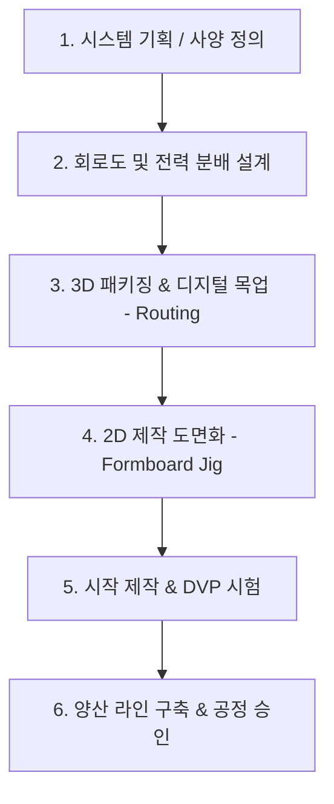
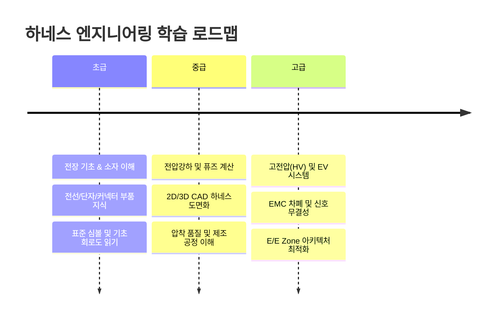

# ⚡ 와이어링 하네스 엔지니어링 (Wire Harness Engineering) 종합 학습 가이드

> **문서 안내**: 본 문서는 자동차, 전장, 항공 및 산업용 전자기기 분야의 핵심인 **와이어 하네스(Wiring Harness) 엔지니어링**을 체계적으로 학습하기 위해 작성된 종합 가이드입니다. 기초 부품 이해부터 2D/3D 설계, 전력 분배, 제조 공정 및 최신 EV 고전압(HV) 트렌드까지 전 과정을 다룹니다.

---

## 📌 목차
1. [와이어 하네스 개요 및 핵심 역할](#1-와이어-하네스-개요-및-핵심-역할)
2. [하네스 핵심 구성 요소 (4대 요소)](#2-하네스-핵심-구성-요소-4대-요소)
3. [하네스 엔지니어링 업무 프로세스](#3-하네스-엔지니어링-업무-프로세스)
4. [전기/회로 설계 핵심 이론](#4-전기회로-설계-핵심-이론)
5. [2D/3D 물리 설계 & 패키징](#5-2d3d-물리-설계--패키징)
6. [제조 공정 및 품질 관리](#6-제조-공정-및-품질-관리)
7. [최신 트렌드: 친환경차(EV) & 차량 아키텍처](#7-최신-트렌드-친환경차ev--차량-아키텍처)
8. [단계별 학습 로드맵 (초급 → 중급 → 고급)](#8-단계별-학습-로드맵)
9. [필수 표준 규격 및 업계 툴](#9-필수-표준-규격-및-업계-툴)
10. [부록: 하네스 엔지니어링 핵심 용어집](#10-부록-하네스-엔지니어링-핵심-용어집)

---

## 1. 와이어 하네스 개요 및 핵심 역할

와이어 하네스는 기기나 차량 내부에 장착된 다양한 전자/전기 부품(센서, 액추에이터, ECU 등) 간에 **전력(Power)**과 **신호(Signal)**를 전달하는 전선 다발 조립체입니다.

* **인체 비유**:
  * **전선(Wire)**: 온몸으로 피를 공급하는 혈관 및 감각을 전달하는 신경망
  * **ECU(제어기)**: 두뇌 및 장기
  * **하네스 결합체**: 이 모든 시스템을 연결하여 유기적으로 작동하게 만드는 전체 배선망
* **하네스의 주요 요구 조건**:
  * 전기적 안정성: 전압 강하 최소화, 신호 무결성(SI), EMC/EMI 차폐
  * 물리/기계적 내구성: 진동, 마모, 굴곡, 장력 저항
  * 환경적 내구성: 고온/저온(-40°C ～ +125°C 이상), 내습/방수, 방진, 내유/내화학성
  * 조립성 및 원가: 경량화, 생산 단가 절감, 차량 생산 라인 작업 편의성

---

## 2. 하네스 핵심 구성 요소 (4대 요소)

하네스는 크게 **전선(Wire)**, **단자(Terminal)**, **커넥터(Connector)**, **보호/고정 부품(Protection & Fasteners)**으로 구성됩니다.

```
+--------------------------------------------------------------+
|                     와이어링 하네스 구조                     |
+--------------------------------------------------------------+
 [커넥터 하우징] <---> [압착 단자(터미널)] <---> [전선(도체/피복)]
        │                                             │
        └─── [씰(Seal) / 그로밋]                 [보호재/클립]
```

### 1) 전선 (Wire & Cable)
* **도체(Conductor)**:
  * 주로 연선(Stranded Copper Wire) 사용 (유연성 및 내굴곡성 확보)
  * 경량화를 위한 알루미늄(Al) 합금 도체 적용 증가 추세
* **절연 피복(Insulation)**:
  * PVC, XLPE(가교 폴리에틸렌), PTFE, 실리콘 등 사용 온도 및 환경에 따라 결정
* **주요 규격**:
  * ISO / JASO / SAE 규격 (예: AVSS, AVS, FLRY-A/B, CAVS 등)
  * 선경 표기: 단면적($\text{mm}^2$ or Sq), AWG(American Wire Gauge)

### 2) 단자 (Terminal)
* 전선과 부품 핀을 전기적으로 연결하는 금속 단자
* **종류**: 암단자(Female), 수단자(Male), 링단자(Ground/Ring Terminal)
* **표면 도금**:
  * 주석(Sn): 일반 신호 및 전력용 (저비용)
  * 은(Ag): 고전압/대전류용
  * 금(Au): 미세 신호, 에어백 등 신뢰성이 극도로 중요한 부위
* **압착부(Crimp Barrel)**: 심선 압착부(Core Crimp)와 피복 압착부(Insulation Crimp)로 구성

### 3) 커넥터 (Connector)
* 단자를 절연 및 기계적으로 보호하며 결합을 유지하는 하우징
* **주요 부속**:
  * **Housing**: 플라스틱 외장체
  * **TPA (Terminal Position Assurance)**: 단자가 하우징에서 빠지지 않도록 2차 락킹
  * **CPA (Connector Position Assurance)**: 암/수 커넥터 체결 분리 방지 락
  * **방수 씰(Gasket / Rubber Seal)**: 수분 침투 방지 (방수 커넥터 vs 비방수 커넥터)

### 4) 보호재 및 고정 부품 (Protection & Clamps)
* **보호재**:
  * 코루게이트 튜브(Corrugated Tube): 내충격, 내마모용 주름관 (일반형/난연형/슬릿형)
  * 테이프(Tape): PVC 테이프, 부직포/면 테이프(흡음 및 이음 방지), 내열 테이프
  * 수축 튜브(Heat Shrink Tube), 브레이드 슬리브(Braid Sleeve)
* **고정/차폐재**:
  * 클립/클램프(Clip/Clamp): 차체 패널 홀에 고정
  * 그로밋(Grommet): 엔진룸-실내 등 격벽 통과 부위의 방수/방음/차진 실링

---

## 3. 하네스 엔지니어링 업무 프로세스

하네스 개발은 회로 기획부터 양산 공정까지 긴밀하게 연계되어 진행됩니다.



1. **사양 검토**: 차량/기기 기능 사양, 부품 위치, I/O 목록, 인터페이스 확인
2. **회로 설계 (Schematic)**: 신호선, 전원선, 접지선 결선 및 퓨즈/릴레이 용량 산정
3. **3D 패키징 (Routing)**: CATIA, NX 등의 3D CAD로 차체 경로 배치, 간섭 및 굽힘 반경 검토
4. **2D 제작 도판 전개**: 3D 번들을 펼쳐 1:1 스케일의 지그보드(Formboard) 도면 제작
5. **시험 및 검증 (DVP&R)**: 통전 시험, 방수 시험, 환경 챔버, 진동 내구성 시험
6. **양산 및 품질 공정**: 압착 품질(Crimp Cross Section), 하네스 테스터 검사

---

## 4. 전기/회로 설계 핵심 이론

### 1) 전압 강하 (Voltage Drop) 계산
전선 길이가 길어지거나 전류가 크면 전압 강하로 인해 부품 오작동이 발생할 수 있습니다.
$$\Delta V = I \times R = I \times \left( \rho \times \frac{L}{A} \right)$$
* $\Delta V$: 전압 강하 ($\text{V}$)
* $I$: 부하 전류 ($\text{A}$)
* $\rho$: 도체 저항률 ($\text{Copper} \approx 0.0178 \, \Omega\cdot\text{mm}^2/\text{m}$)
* $L$: 전선 전체 길이 ($\text{m}$)
* $A$: 전선 도체 단면적 ($\text{mm}^2$)

> **설계 팁**: 일반 차량 12V 시스템에서는 부하 인가 시 통상 허용 전압 강하를 $0.5\text{V} \sim 1.0\text{V}$ 이내로 관리합니다.

### 2) 퓨즈 및 릴레이 선정 (Protection)
* **정격 전류(Rated Current)**: 정상 작동 전류의 약 $125\% \sim 150\%$ 수준으로 퓨즈 선정
* **전선 보호 원칙**: 퓨즈의 차단 곡선이 전선의 발연/단선 한계 곡선보다 항상 아래(빠른 차단)에 위치해야 함
* **돌입 전류(Inrush Current)**: 모터나 램프류 부하의 초기 돌입 전류를 견디는 슬로우 블로우(Slow-blow) 퓨즈 고려

### 3) 노이즈 저감 및 접지 (Grounding / EMC)
* **Twisted Pair (연선 꼬임)**: CAN, 이더넷 등 통신선에 차동 신호를 사용할 때 외부 자계 유도 노이즈 상쇄
* **Shielding (차폐)**: 고주파 통신선 및 고전압(HV) 케이블에 알루미늄 포일 또는 편조 차폐 적용
* **Ground 루프 방지**: 신호용 그라운드(Signal GND)와 파워용 그라운드(Power GND)의 분리 설계

---

## 5. 2D/3D 물리 설계 & 패키징

### 1) 3D 하네스 라우팅 (Packaging)
* **간섭 회피**: 배기 매니폴드, 터보차저 등 고열원(Heat Source)과의 최소 이격거리 확보 (열 차폐판 필요성 검토)
* **가동 부위 여유장(Slack)**: 엔진 롤(Roll), 서스펜션 상하 운동, 도어 힌지 개폐 부위의 배선 처짐 및 인장 방지
* **최소 굽힘 반경(Minimum Bending Radius)**:
  * 일반 전선: 외경($D$)의 3～5배 이상
  * 고전압/차폐선: 외경($D$)의 6～10배 이상 확보

### 2) 2D 지그보드(Formboard) 도면 전개
* 3D 형상을 작업자가 조립할 수 있는 평면 1:1 원척 지그 도면으로 변환
* 분기점(Breakout point) 치수, 테이핑 권선 피치, 튜브 장착 위치, 라벨 부착 위치 표기

---

## 6. 제조 공정 및 품질 관리

하네스 제조는 전형적인 노동/장비 복합 공정으로 품질 검증이 매우 엄격합니다.

| 공정 단계 | 주요 작업 내용 | 핵심 품질 관리 항목 |
| :--- | :--- | :--- |
| **1. 절단/탈피 (Cut & Strip)** | 전선을 정촌으로 자르고 피복을 벗김 | 절단 길이 공차, 심선 손상(Nick) 유무 |
| **2. 단자 압착 (Crimping)** | 자동 압착기를 통해 단자와 도체 결합 | **C/H(Crimp Height)**, **C/W(Crimp Width)**, 인장 강도(Pull-off force) |
| **3. 서브 조립 (Sub-Assy)** | 접합(Splice), 방수 씰 삽입, 꼬임 공정 | 조음/접합 저항, 씰링 파손 검사 |
| **4. 메인 조립 (Assembly)** | 도판(Formboard) 위에서 배선 및 테이핑 | 분기 치수, 테이프 마감, 클립 누락 방지 |
| **5. 전기 검사 (Testing)** | 하네스 테스터 지그에 결합하여 자동 측정 | 오배선(Miswiring), 단선(Open), 단락(Short), 접촉 저항 |
| **6. 외관 및 비전 검사** | 색상, 락킹 상태, 라벨 바코드 확인 | TPA/CPA 삽입 확인, 에어 리크(방수) 테스트 |

> **단자 압착 단면 검사 (Crimp Cross-Section)**:
> 단자 압착 시 심선 사이에 빈 공간(Void)이 없어야 하며, C-factor 및 압착 높이가 규격 범위 내에 들어야 합니다.

---

## 7. 최신 트렌드: 친환경차(EV) & 차량 아키텍처

### 1) 고전압(High Voltage, HV) 시스템
* **전압 레벨**: 400V ～ 800V 급 시스템 (배터리, 인버터, 구동모터 연결)
* **특징**:
  * 식별을 위한 **주황색(Orange) 피복** 필수 적용
  * **HVIL (High Voltage Interlock Loop)**: 커넥터 분리 시 감전을 막기 위해 메인 릴레이를 사전 차단하는 안전 루프 회로
  * 대용량 전력 전송을 위한 **버스바(Busbar)** 적용 확대

### 2) 경량화 기술 (Lightweighting)
* **알루미늄 전선(Aluminum Wire)**: 구리 대비 약 30～40% 중량 절감
  * 과제: 갈바닉 부식(Galvanic Corrosion) 방지를 위한 단자 방수 밀봉 기술(초음파 융착, 부식방지 몰딩)
* **박피 전선(Ultra-thin Wall Insulation)**: 피복 두께를 줄여 외경 및 무게 축소

### 3) E/E 아키텍처 진화 (Zone Architecture)
* 기존 분산형(Distributed) → 도메인형(Domain) → **영역 기반(Zone-based) 아키텍처**로 전환
* 차량 내 하네스 총 길이와 무게를 대폭 줄이고 이더넷 백본(Ethernet Backbone)을 중심으로 단순화

---

## 8. 단계별 학습 로드맵



### [Step 1] 기초 단계 (입문)
- [ ] 전기/전자 기초: 옴의 법칙, 줄열($I^2R$), 전압강하, 교류/직류
- [ ] 하네스 구성품 파악: 도체, 단자, 하우징, 씰, 튜브, 클립
- [ ] 도면 독해: 자동차/전장 회로 기호(Symbol), 커넥터 핀맵(Pinout) 확인법
- [ ] 추천 교재/자료: IPC/WHMA-A-620 기초 규격 가이드

### [Step 2] 중급 단계 (실무 역량)
- [ ] 부품 선정 실무: 허용 전류표 분석, 환경 온도에 따른 Derating 계수 계산
- [ ] 3D 하네스 라우팅 툴 실습 (CATIA Electrical Workbench 또는 Siemens NX)
- [ ] 2D 전기 CAD 실습 (Siemens Capital, Zuken E3.series, Auto-CAD Electrical 등)
- [ ] 생산 공정 이해: 압착 높이(C/H) 관리, 인장 시험 기준, 불량 유형 분석

### [Step 3] 고급 단계 (전문가)
- [ ] 친환경차 고전압 하네스 설계: HVIL 회로 설계, 차폐(Shielding) 및 본딩
- [ ] EMC/EMI 대책: 고주파 통신(CAN-FD, Automotive Ethernet) 라우팅 규칙
- [ ] 설계 검증: DFMEA(설계 고장 모드 영향 분석), DVP&R(설계 검증 계획 및 보고서)
- [ ] 차세대 차량 E/E 아키텍처(Zone Controller)와 하네스 모듈화 분석

---

## 9. 필수 표준 규격 및 업계 툴

### 1) 국제 표준 및 산업 규격
* **IPC/WHMA-A-620**: 케이블 및 와이어 하네스 조립품의 요구조건 및 허용 기준 (글로벌 표준)
* **USCAR-21**: 자동차 전선 단자 압착 성능 표준 (SAE/USCAR)
* **ISO 6722 / ISO 19642**: 자동차용 저전압 및 고전압 케이블 규격
* **LV 214 / LV 215**: 독일 자동차 업계 자동차 커넥터 및 고전압 접촉 단자 시험 규격

### 2) 업계 표준 소프트웨어
* **3D CAD**: CATIA V5/3DEXPERIENCE (EHI/EHA), Siemens NX (Routing), Creo
* **2D 전기/하네스 전용 툴**: 
  * Siemens Capital (구 Mentor Capital) - 글로벌 자동차 업계 1위 툴
  * Zuken E3.series
  * Dassault Systèmes Aucotec / Engineering Base

---

## 10. 부록: 하네스 엔지니어링 핵심 용어집

| 용어 | 영문 풀이 | 설명 |
| :--- | :--- | :--- |
| **Cavity** | 캐비티 | 커넥터 하우징에서 단자가 삽입되는 개별 구멍/방 |
| **Crimping** | 크림핑(압착) | 툴을 이용해 단자의 배럴을 전선 심선 및 피복에 소성 변형시켜 고정하는 공정 |
| **C/H, C/W** | Crimp Height / Width | 단자 압착 후의 높이와 너비 (전기적 저항 및 기계적 체결력 결정 기준) |
| **Pull Test** | 인장 시험 | 압착된 단자와 전선을 당겨 결합 강도를 측정하는 파괴 검사 |
| **Splice** | 조인트 / 스플라이스 | 여러 가닥의 전선을 초음파 융착이나 압착 슬리브로 한 지점에서 연결하는 작업 |
| **Grommet** | 그로밋 | 차체 관통 홀에 장착하여 실내 유입수 방지 및 전선 쓸림을 방지하는 고무 패킹 |
| **HVIL** | High Voltage Interlock Loop | 고전압 커넥터 분리 시 전원을 차단하여 작업자를 보호하는 저전압 안전 감시 루프 |
| **Formboard** | 폼보드 (조립 지그 도판) | 하네스 제작 시 1:1 도면 위에 지그 핀을 꽂아 배선 및 테이핑하는 작업대 |

---

> 💡 **참고 (소프트웨어 테스트 하네스와의 차이)**:
> 프로그래밍/소프트웨어 공학에서 말하는 '테스트 하네스(Test Harness)'는 소프트웨어 모듈을 테스트하기 위해 드라이버와 스텁(Stub)으로 둘러싼 테스트 실행 환경을 의미합니다. 본 문서는 제조업 및 전장 산업의 물리적 **와이어 하네스 엔지니어링**을 중점적으로 다룹니다.
